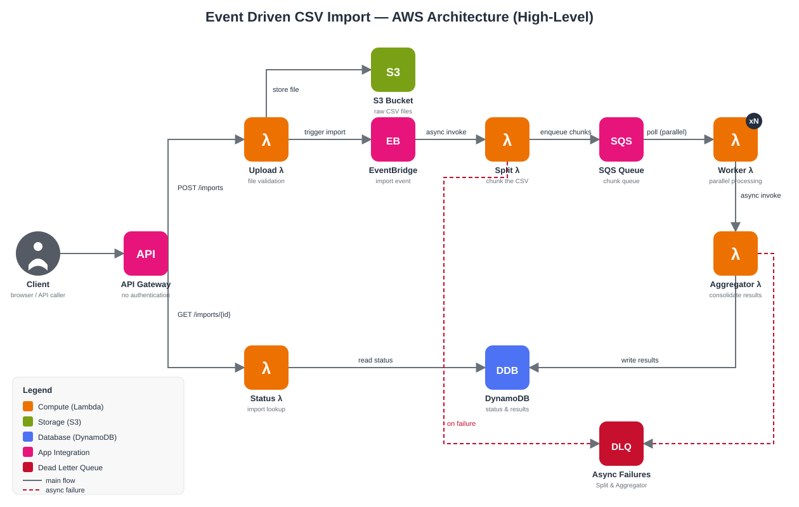

# Event Driven CSV Import

Serverless platform for large-scale CSV imports on AWS. The project keeps the flow simple, fast, and easy to evolve.

## Overview

The system simulates an asynchronous ingestion pipeline with upload, split, parallel processing, aggregation, and status lookup. The repository keeps a clear separation between contracts, business logic, and infrastructure.



## Project Structure

- `lambdas/upload`: API entry point and file validation
- `lambdas/split`: CSV chunking
- `lambdas/worker`: parallel chunk processing
- `lambdas/aggregator`: result consolidation
- `lambdas/status`: import lookup
- `shared`: types, validations, in-memory storage, structured logging, and metrics
- `tests`: unit and end-to-end coverage
- `terraform`: infrastructure as code
- `bootstrap`: one-time AWS setup for the CI/CD deploy (remote-state bucket, GitHub OIDC deploy role)
- `scripts`: shell helpers for Docker, Terraform, and API-collection workflows
- `postman`: API collection for the implemented routes, including error-path examples
- `local`: config for the local observability stack (Prometheus, Grafana, Loki, Promtail)
- `docs`: architecture and flow diagrams (`docs/mmd` Mermaid sources, `docs/img` rendered SVGs)

## Prerequisites

- Node.js 22 or newer
- Docker and Docker Compose
- Terraform

## Quick Start

1. Install dependencies with `npm install`.
2. Run `npm run typecheck` to validate TypeScript.
3. Run `npm run lint` to check code style.
4. Run `npm run format` to check Prettier formatting (`npm run format:fix` to apply it).
5. Run `npm run test:coverage` to run the unit suite with 100% coverage enforcement.
6. Run `npm run test:localstack` to execute the end-to-end flow against LocalStack.

## LocalStack

The repository is ready to run with LocalStack through `docker-compose.local.yml` and the helper scripts in `scripts/`.

1. Start the local stack with `npm run local:up`.
2. Run the end-to-end flow with `npm run test:localstack`.
3. Stop the local stack with `npm run local:down`.

The Terraform helpers are:

1. `npm run terraform:init`
2. `npm run terraform:fmt`
3. `npm run terraform:validate`
4. `npm run terraform:plan`
5. `npm run terraform:apply -- -var use_localstack=true -auto-approve` — deploys the full stack (API Gateway, all 5 Lambdas, S3, DynamoDB, SQS, EventBridge) into LocalStack. Requires `npm run package:lambdas` first (builds `terraform/build/lambda.zip`) and the LocalStack container to have `/var/run/docker.sock` mounted (already the case for `npm run local:up`), since LocalStack's Lambda service runs each function in its own Docker container.
6. `npm run terraform:destroy -- -var use_localstack=true -auto-approve` — tears the deployed stack back down.

`npm run test:localstack` exercises the flow by calling the handlers directly (creating its own bucket/table/queue on the fly) and doesn't need `terraform:apply` first. A `terraform:apply`'d stack is a real, independently-running deployment — the EventBridge → Split → SQS → Worker → Aggregator chain fires on its own once the Upload Lambda is invoked, with no test code driving it.

## Deploy to AWS (GitHub Actions)

Pushes to `main` deploy to real AWS through the `deploy` job in [.github/workflows/ci-cd.yml](.github/workflows/ci-cd.yml), after `validate` and `e2e-localstack` pass. It authenticates with GitHub OIDC, so no AWS access keys are stored in GitHub. Until it is configured, the job skips the AWS steps and stays green.

No `backend` block is committed (see [terraform/versions.tf](terraform/versions.tf)): local runs and the LocalStack job use local state, and the deploy job writes a `ci_backend.tf` with an S3 backend right before `terraform init`, using the bucket created by [bootstrap/](bootstrap/) with native S3 locking (`use_lockfile`, no DynamoDB table). Once the pipeline owns the real AWS stack, don't also `apply` it manually with local state: the two states would diverge.

One-time setup:

1. Apply [bootstrap/](bootstrap/) with your own admin credentials. It creates the remote-state bucket and the `event-driven-data-ingestion-github-deploy` IAM role, which only the `production` environment of this repo can assume:

   ```bash
   cd bootstrap
   terraform init
   terraform apply   # default region: eu-west-2; override with -var="aws_region=..."
   # add -var="create_oidc_provider=true" on an account that doesn't have the GitHub OIDC provider yet
   ```

   An AWS account can only have one `token.actions.githubusercontent.com` OIDC provider, so `create_oidc_provider` defaults to `false`, reusing the one another project's bootstrap already created in the same account.

2. In GitHub → Settings → Environments, create `production` and add:
   - variables `AWS_DEPLOY_ROLE_ARN`, `TF_STATE_BUCKET` and `AWS_REGION`, copied from the bootstrap outputs
   - optional variable `RESERVE_LAMBDA_CONCURRENCY` (default `false`). New AWS accounts have a 10-execution concurrency limit, which leaves nothing to reserve; raise the _Lambda → Concurrent executions_ quota in Service Quotas first, then set it to `true` to apply the `*_reserved_concurrency` values
   - optional variable `MANAGE_API_GATEWAY_ACCOUNT_SETTINGS` (default `true`). The API Gateway CloudWatch Logs role is one setting per account and region; set `false` if another stack in the same account/region already manages it
   - optional protection rules (required reviewers) to approve each deploy by hand

3. Push to `main` (or run **Actions → CI-CD → Run workflow** on `main`). The job packages the Lambdas, runs `terraform plan` + `apply`, then smoke-tests the live API: `GET /imports` must return `200` and `GET /imports/{unknown id}` `404`. The API URL (`https://<id>.execute-api.<region>.amazonaws.com/dev`) is printed in the job summary.

The imports bucket is named `<project>-<environment>-imports-<account id>` so it is globally unique; set `imports_bucket_name` to override it. Lambdas run on `nodejs22.x` on AWS (`nodejs20.x` is deprecated there) and on `nodejs20.x` in LocalStack.

### Tear down / recreate

To stop paying for the stack while it's unused (mainly the WAF web ACL, a fixed monthly cost), run **Actions → Destroy → Run workflow** on `main` and type `destroy` to confirm. It runs `terraform destroy` against the same S3 state, deleting every resource in [terraform/](terraform/), S3 imports and DynamoDB data included. The [bootstrap/](bootstrap/) resources (state bucket, OIDC provider, deploy role) are kept, so recreating it needs no setup: run **Actions → CI-CD → Run workflow** on `main` (any push to `main` also redeploys).

The deploy role's permissions ([bootstrap/deploy_permissions.tf](bootstrap/deploy_permissions.tf)) are scoped to resources named with the `event-driven-data-ingestion-` prefix wherever AWS supports it. It can only attach the three AWS-managed policies the stack uses to roles it creates, and can't modify itself.

## Observability (local)

`npm run local:up` also starts a local observability stack alongside LocalStack:

- **Grafana** — http://localhost:3000 (`admin` / `admin`), with a `Lambda overview` dashboard pre-provisioned (invocations, error rate, p95 duration, and logs)
- **Prometheus** — http://localhost:9090
- **Pushgateway** — http://localhost:9091 (Lambdas are short-lived, so each invocation pushes its metrics here instead of being scraped directly)
- **Loki** — logs from every local container, parsed as JSON and filterable by function via the `scope` label (see `shared/logger.ts`)

This is only wired up locally: Lambdas only push metrics when `PUSHGATEWAY_URL` is set, which Terraform only does when `use_localstack = true` (see `terraform/variables.tf`). A real AWS deployment never sets it, so it never attempts to reach a Pushgateway. When applying Terraform locally, pass `-var use_localstack=true` (and `-var localstack_endpoint=...` as needed) so the Lambdas are wired to the local Pushgateway.

## Observability & Resilience (AWS)

On top of the local stack above, a real AWS deployment gets:

- **CloudWatch Logs** — every Lambda's log group has an explicit `retention_in_days` (`terraform/modules/lambda`), so logs don't accumulate (and get billed) forever.
- **CloudWatch Alarms** (`terraform/modules/alarms`) — Errors, Throttles, and near-timeout Duration per Lambda; 4XX/5XX on the API Gateway stage; a queue-depth alarm on the async-failures DLQ (see "Why there's no Step Functions" below). Skipped when `use_localstack = true`, same as the existing dashboard.
- **X-Ray** — active tracing on every Lambda and the API Gateway stage, so a request that crosses Upload → EventBridge → Split → SQS → Worker → Aggregator can be followed as one trace.
- **Dead-letter queues** — a shared SQS queue catches failed _asynchronous_ Lambda invocations (`dead_letter_config`): Split's (EventBridge invokes it async) and the Aggregator's (the Worker invokes it async). This is separate from the SQS processing queue's own DLQ (Worker message failures), which is backed by that queue's redrive policy instead.
- **Reserved concurrency** — every Lambda can get a `reserved_concurrent_executions` cap (the `*_reserved_concurrency` variables in `terraform/variables.tf`, switched on by `reserve_lambda_concurrency`), so a runaway function can't starve the account's shared concurrency pool. The CI/CD deploy leaves it off by default, since new accounts have no concurrency to reserve (see [Deploy to AWS](#deploy-to-aws-github-actions)).
- **API Gateway throttling & access logs** — stage-wide rate/burst limits (`aws_api_gateway_method_settings`) and structured JSON access logs to their own log group.
- **IAM least privilege** — Aggregator and Status each get their own role scoped to what they actually call (Aggregator: DynamoDB only, no S3/SQS; Status: read-only DynamoDB). Upload and Split still share a role since their access needs genuinely overlap.
- **Lambda versioning/aliases** — every function publishes a version on each deploy and gets a `live` alias, so the infrastructure for gradual rollout/rollback exists. Current callers (API Gateway, EventBridge, the Worker's Aggregator invoke, the SQS event source mapping) still target `$LATEST` directly — pointing them at the alias instead, with weighted traffic shifting, is a deliberate follow-up rather than something this change silently switched on.

### Why there's no Step Functions

An earlier version of this stack ran EventBridge → Step Functions → Split, with Step Functions doing nothing but invoking that one Lambda. A state machine that orchestrates exactly one Task adds a resource, an IAM role, a log group, and per-state-transition billing without buying anything a direct invocation doesn't already give you. It was removed: EventBridge now targets the Split Lambda directly, and the same resilience (retry, dead-lettering) comes from Lambda's own built-in async-invoke behavior — the identical mechanism already used for the Worker → Aggregator hop — via `dead_letter_config` on the Split function, backed by the shared async-failures queue above. If a future revision needs actual branching, parallel steps, or a human-approval wait between upload and processing, Step Functions would earn its place back at that point; today's pipeline is a straight line, so it doesn't.

Two things worth knowing before applying to a shared AWS account:

- `aws_api_gateway_account` (the CloudWatch Logs role that access logging needs) is an **account-wide, one-per-region** setting, not per-API. If another stack in the same account already manages it, set `-var manage_api_gateway_account_settings=false` here to avoid two Terraform configs fighting over it.
- None of this includes an `aws_budgets_budget` cost alarm — that's normally set once at the account level rather than per-stack, and threshold/notification target are a call for whoever owns the AWS bill.

## API

The implemented API surface is intentionally small and matches the current Lambda handlers. No route requires authentication — an intentional portfolio-project decision (see `.checkov.yaml`), not an oversight, so the API and its Postman collection can be exercised with zero setup.

- `POST /imports`
- `GET /imports`
- `GET /imports/{id}`

The Postman collection in `postman/event-driven-csv-import.postman_collection.json` mirrors those routes, with `pm.test` assertions and error-path examples (invalid file extension, malformed payload, unknown import id). It targets `{{baseUrl}}`, which must be a deployed API Gateway invoke URL (LocalStack via Terraform, or a real AWS deployment) — the handlers aren't reachable over HTTP without one.

Run it with `npm run test:postman` (`scripts/postman-test.sh`) after `npm run terraform:apply -- -var use_localstack=true -auto-approve`: the script reads the real, LocalStack-reachable URL from `terraform output api_invoke_url` and runs the collection against it via [Newman](https://github.com/postmanlabs/newman). Newman is deliberately **not** a project dependency — its own transitive deps (`postman-runtime`/`postman-sandbox`) carry long-standing, unfixed high/critical advisories that would otherwise show up in every `npm audit` run — so the script invokes it through `npx` instead, keeping it out of `package.json`/`package-lock.json` entirely. CI runs this exact flow (see [Verification](#verification)).

Note: `aws_api_gateway_stage.invoke_url` (what the AWS Terraform provider computes) always renders the real-AWS domain format, even against LocalStack, so it's unusable there. `terraform/outputs.tf` accounts for this: when `use_localstack = true`, `api_invoke_url` instead returns the LocalStack-reachable `.../restapis/{id}/{stage}/_user_request_` path.

## Documentation

Diagrams are authored as Mermaid sources in [`docs/mmd`](docs/mmd) and rendered to SVG in [`docs/img`](docs/img) (regenerate with `npx @mermaid-js/mermaid-cli -i docs/mmd/<name>.mmd -o docs/img/<name>.svg -b transparent` after editing a source). Keep both in sync with the code when the flow they describe changes.

- System architecture: [`docs/mmd/architecture.mmd`](docs/mmd/architecture.mmd) / [`docs/arch/architecture.svg`](docs/arch/architecture.svg)
- Main components and modules: [`docs/mmd/components.mmd`](docs/mmd/components.mmd) / [`docs/img/components.svg`](docs/img/components.svg)
- Write path (upload → split → workers → aggregator): [`docs/mmd/write-flow.mmd`](docs/mmd/write-flow.mmd) / [`docs/img/write-flow.svg`](docs/img/write-flow.svg)
- Read path (status lookup): [`docs/mmd/read-flow.mmd`](docs/mmd/read-flow.mmd) / [`docs/img/read-flow.svg`](docs/img/read-flow.svg)
- Domain model / DynamoDB single-table design: [`docs/mmd/domain-model.mmd`](docs/mmd/domain-model.mmd) / [`docs/img/domain-model.svg`](docs/img/domain-model.svg)
- Import status lifecycle: [`docs/mmd/import-status-lifecycle.mmd`](docs/mmd/import-status-lifecycle.mmd) / [`docs/img/import-status-lifecycle.svg`](docs/img/import-status-lifecycle.svg)
- Local deployment / container stack: [`docs/mmd/local-deployment.mmd`](docs/mmd/local-deployment.mmd) / [`docs/img/local-deployment.svg`](docs/img/local-deployment.svg)

## Verification

CI/CD (`.github/workflows/ci-cd.yml`) runs on every push and pull request to `main`, in three jobs.

**validate**:

1. Dependency audit (`npm audit --audit-level=high`)
2. Prettier formatting check (`npm run format`)
3. Lint (`npm run lint`)
4. Typecheck (`npm run typecheck`)
5. Unit tests with 100% coverage enforcement (`npm run test:coverage`)
6. Build (`npm run build`)
7. Terraform formatting check (`terraform fmt -check -recursive`) for `terraform/` and `bootstrap/`
8. Terraform init and validate for `terraform/` and `bootstrap/` (`-backend=false`, no credentials needed)
9. Terraform lint (`tflint --recursive`, config in `terraform/.tflint.hcl`)
10. Terraform static analysis (`checkov --config-file .checkov.yaml`) — findings that don't apply to this project's scale (e.g. Lambda-in-a-VPC, DynamoDB with a customer-managed KMS key) are explicitly skipped in that config file, each with a one-line reason, rather than silenced globally

**e2e-localstack** (after validate):

1. Package the Lambdas (`npm run package:lambdas`)
2. Start LocalStack (with `/var/run/docker.sock` mounted) and wait for it to report healthy
3. LocalStack end-to-end test (`npm run test:localstack`) — drives the handlers directly
4. Deploy the full stack into LocalStack (`npm run terraform:apply -- -var use_localstack=true -auto-approve`)
5. API/collection tests against the deployed stack (`npm run test:postman`)
6. Tear down: `terraform:destroy` then stop the LocalStack container (both run unconditionally, even if an earlier step failed)

**deploy** (push or manual run on `main`, after both): assumes the deploy IAM role via GitHub OIDC in the `production` environment, runs `terraform plan` + `apply` against real AWS with S3 remote state, and smoke-tests the live API. Terraform errors are surfaced as run annotations. See [Deploy to AWS (GitHub Actions)](#deploy-to-aws-github-actions).

The **Destroy** workflow (`.github/workflows/destroy.yml`, manual only) tears the AWS stack down — see [Tear down / recreate](#tear-down--recreate).
